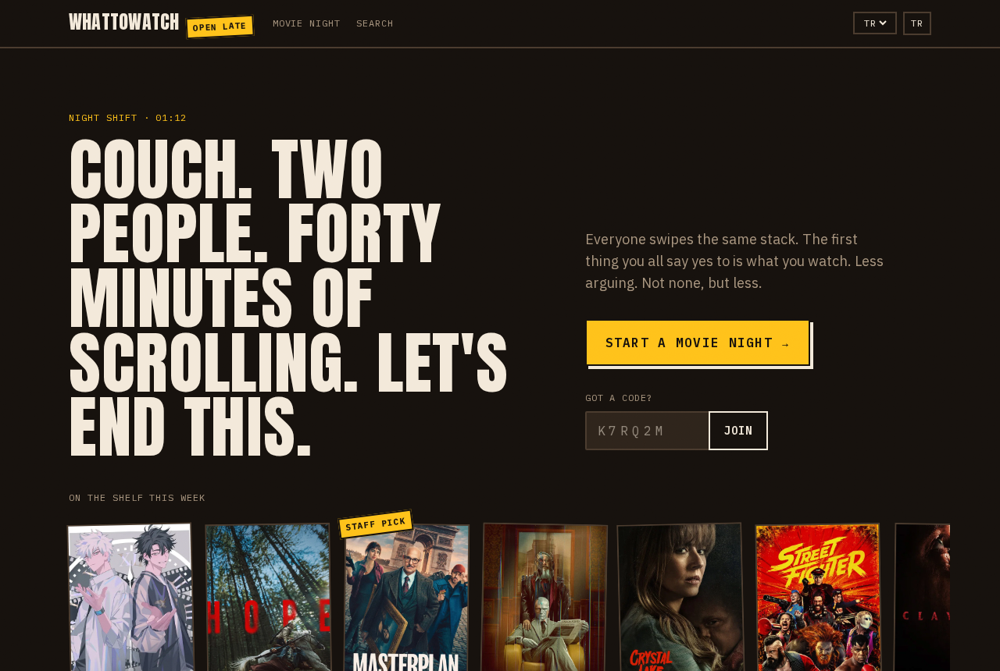

# WhatToWatch

Couch. Two people. Forty minutes of scrolling. This is for ending that.

Everyone swipes the same stack of movies or shows. Right is yes, left is no, up is "seen it". The first title everybody says yes to is what you watch.

**https://whattowatchxinny.vercel.app**



## Two ways to play

**Live room.** One person sets up the night: movies or series, which services you actually pay for, up to three genres, a bedtime limit, new or old. That makes a room with a six-character code (no 0, O, 1 or I, so it survives being read out loud). Everyone joins and swipes at once. Phones check in every two seconds, and when the last yes lands, every screen says so.

**Link mode.** No server state at all. The deck is built from a seed in the URL, so everyone gets the same cards in the same order. You swipe, then send a link that carries your picks. They swipe the same deck and the overlap shows up on their screen. They can send it back, or pass it on to a third person.

A match means everyone currently in the room liked it. If anyone marks it "seen it", it's out. Keep swiping to collect more; the shortlist ranks them by which you agreed on first.


There's also plain search with where-to-watch per country (stream, rent, buy), detected from where you are and changeable from the header.

No accounts. You're an anonymous device id plus whatever name you type.

## What's in here

| Path | What it is |
| --- | --- |
| `apps/web` | Next.js. Landing, search, title, person and collection pages, and the TMDB proxy at `/api/tmdb/*`. Default microfrontend; owns `microfrontends.json`. |
| `apps/match` | Next.js, served under `/match`. Setup, lobby, deck, match screen, shortlist, room API. |
| `apps/mobile` | Expo Router app with the same flow. Talks to the deployed web API, never to TMDB. |
| `packages/core` | Plain TypeScript, no React. TMDB client and mappers, deck builder, seeded shuffle, match rule, link codec, rooms, EN/TR strings. Unit tested. |
| `packages/tokens` | Colours, type, spacing, swipe physics. Read by Tailwind on the web and by StyleSheet on mobile. |
| `packages/ui` | Shared web pieces for both Next apps: shell, poster, provider list, server-only TMDB access. |
| `packages/config` | Shared tsconfig and ESLint. |

The two Next apps deploy as separate Vercel projects (`whattowatch-web`, `whattowatch-match`) in one microfrontends group, so `/match/*` is routed to the second one under the same domain.

## Running it

You need Node 22+, pnpm 12, and a TMDB API key or read token from https://www.themoviedb.org/settings/api.

```sh
pnpm install
printf 'TMDB_READ_TOKEN=%s\n' "$YOUR_TMDB_TOKEN" | tee apps/web/.env.local apps/match/.env.local > /dev/null
pnpm build
```

Run both apps behind the local microfrontends proxy, then open http://localhost:3024:

```sh
pnpm --filter whattowatch-web start
ROOM_STORE=memory pnpm --filter whattowatch-match start
pnpm --dir apps/web exec microfrontends proxy microfrontends.json --local-apps whattowatch-web whattowatch-match
```

Live rooms use Upstash Redis when `UPSTASH_REDIS_REST_URL`/`_TOKEN` (or `KV_REST_API_URL`/`_TOKEN`) are set. Without them, `ROOM_STORE=memory` keeps rooms in memory for local use. In production with neither, the setup screen offers link mode only.

Mobile:

```sh
cd apps/mobile
EXPO_PUBLIC_API_URL=https://whattowatchxinny.vercel.app npx expo start
```

## Checks

```sh
pnpm turbo run lint typecheck test build   # everything, including both mobile exports
pnpm e2e                                    # Playwright: link mode and live mode, locally
E2E_BASE_URL=https://whattowatchxinny.vercel.app pnpm e2e   # link mode against production
```

## Notes

The TMDB credential only lives on the server. The browser and the app call `/api/tmdb/*` and `/match/api/*`, never TMDB directly.

Decisions and their reasons are logged in `docs/PROGRESS.md`. `REPORT.md` has what shipped and what didn't. `HUMAN_TODO.md` lists the steps that need your accounts.

This product uses the TMDB API but is not endorsed or certified by TMDB.
