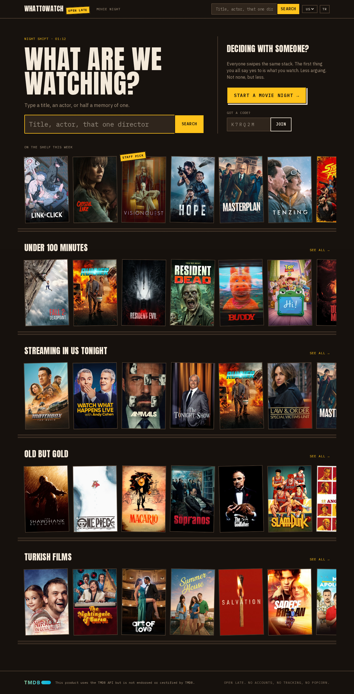
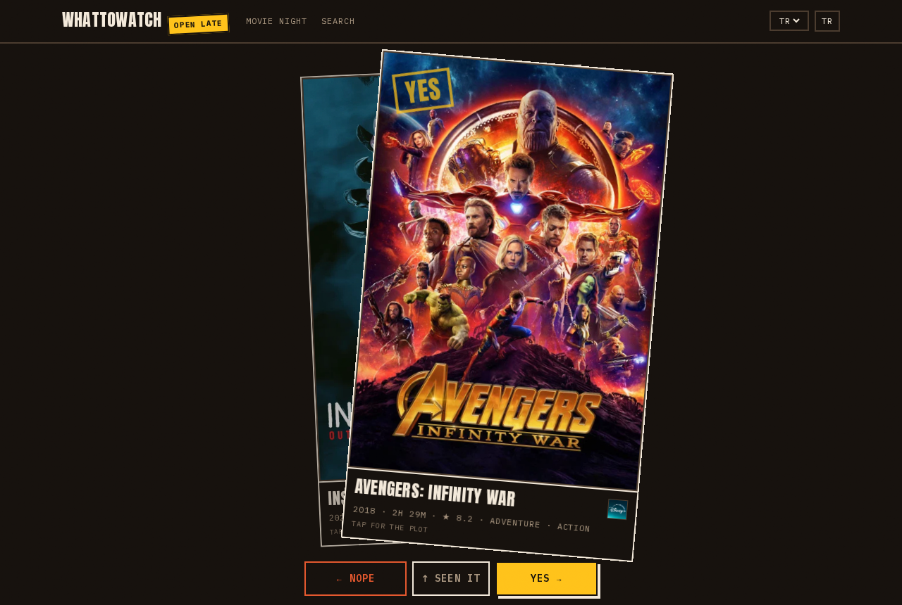

# WhatToWatch

Something to watch, found fast. Search first: type a title, an actor or half a memory, and suggestions show up as you type. Or browse with filters that live in the URL: under 100 minutes, only on the services you pay for, old but gold, Turkish only.

When there's two of you, start a movie night. Everyone swipes the same stack: right is yes, left is no, up is "seen it". You find out what you agreed on at the end.

**https://whattowatchxinny.vercel.app**



## Two ways to play

**Rounds.** Whoever starts votes 10 cards. If fewer than 30% are yeses, five more come, and so on up to 30. "Seen it" doesn't count; the next card takes its place. A tape counter always says where you are: `LIKED 2 / NEED 3 · CARD 7 OF 10`.

**Link mode.** No server state at all. When your rounds are done you get a link that carries the exact cards you voted on and your votes, and a screen that says how many you liked but not which. Your friend swipes exactly those cards, sees nothing until the last one, then gets the results: what you both said yes to, with where to watch it. They can send the results back, or add a third person to the same deck.

**Live room.** One person sets up the night: movies or series, which services you pay for, up to three genres, a bedtime limit, new or old. That makes a room with a six-character code (no 0, O, 1 or I, so it survives being read out loud). Everyone swipes the same deck at once. If anyone is under 30% when everyone is through, the room deals five more for all. Results show up for everyone once the last person finishes.

A title makes the results when everyone liked it. If anyone marked it "seen it", it's out.



Where-to-watch is per country (stream, rent, buy), detected from where you are and changeable from the header.

No accounts. You're an anonymous device id plus whatever name you type.

## What's in here

| Path | What it is |
| --- | --- |
| `apps/web` | Next.js. Landing, search with filters, title, person and collection pages, `/api/suggest`, and the TMDB proxy at `/api/tmdb/*`. Default microfrontend; owns `microfrontends.json`. |
| `apps/match` | Next.js, served under `/match`. Setup, lobby, rounds, share screen, results, room API. |
| `apps/mobile` | Expo Router app with the same flow. Talks to the deployed web API, never to TMDB. |
| `packages/core` | Plain TypeScript, no React. TMDB client and mappers, deck builder, seeded shuffle, round rule, results, link codec, search params, rooms, EN/TR strings. Unit tested. |
| `packages/tokens` | Colours, type, spacing, swipe physics. Read by Tailwind on the web and by StyleSheet on mobile. |
| `packages/ui` | Shared web pieces for both Next apps: shell, poster, provider list, server-only TMDB access. |
| `packages/config` | Shared tsconfig and ESLint. |

The two Next apps deploy as separate Vercel projects (`whattowatch-web`, `whattowatch-match`) in one microfrontends group, so `/match/*` is routed to the second one under the same domain.

## Running it

You need Node 22+, pnpm 12, and a TMDB API key or read token from https://www.themoviedb.org/settings/api.

```sh
pnpm install
printf 'TMDB_READ_TOKEN=%s\n' "$YOUR_TMDB_TOKEN" | tee apps/web/.env.local apps/match/.env.local > /dev/null
pnpm build
```

Run both apps behind the local microfrontends proxy, then open http://localhost:3024:

```sh
pnpm --filter whattowatch-web start
ROOM_STORE=memory pnpm --filter whattowatch-match start
pnpm --dir apps/web exec microfrontends proxy microfrontends.json --local-apps whattowatch-web whattowatch-match
```

Live rooms use Upstash Redis (on in production) when `UPSTASH_REDIS_REST_URL`/`_TOKEN` (or `KV_REST_API_URL`/`_TOKEN`) are set. Without them, `ROOM_STORE=memory` keeps rooms in memory for local use. In production with neither, the setup screen offers link mode only.

Mobile:

```sh
cd apps/mobile
EXPO_PUBLIC_API_URL=https://whattowatchxinny.vercel.app npx expo start
```

## Checks

```sh
pnpm turbo run lint typecheck test build   # everything, including both mobile exports
pnpm e2e                                    # Playwright: rounds, results, live rooms and search, locally
E2E_BASE_URL=https://whattowatchxinny.vercel.app pnpm e2e   # the same against production (add E2E_LIVE=1 for live rooms)
```

## Notes

The TMDB credential only lives on the server. The browser and the app call `/api/tmdb/*` and `/match/api/*`, never TMDB directly.

Decisions and their reasons are logged in `docs/PROGRESS.md`. `REPORT.md` has what shipped and what didn't. `HUMAN_TODO.md` lists the steps that need your accounts.

This product uses the TMDB API but is not endorsed or certified by TMDB.
